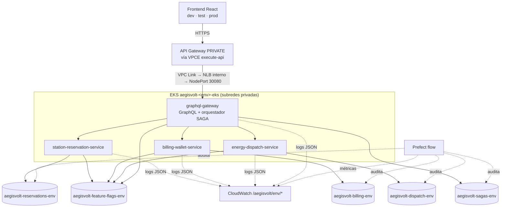

# AegisVolt

Plataforma cloud-native de gestión de carga para flotas eléctricas y electrolineras B2B.
Proyecto final de **Patrones Arquitectónicos Avanzados**: SAGA orquestada con transacciones
compensatorias, microservicios en Kubernetes, GraphQL, Feature Flags por ambiente,
Terraform con workspaces sobre Floci, CI/CD con Canary Deployment y observabilidad con
CloudWatch y Prefect.



La documentación de la arquitectura está en [`docs/arquitectura.md`](docs/arquitectura.md), la guía de la sustentación pregunta por pregunta en [`docs/sustentacion.md`](docs/sustentacion.md) y la configuración de GitHub y GitLab en [`docs/setup-github-gitlab.md`](docs/setup-github-gitlab.md).

## Estructura

```text
libs/aegis_common/       config, clientes AWS/Floci, logs JSON (correlation_id), feature flags, seed
services/
  station-reservation/   paso 1 de la SAGA: AVAILABLE -> RESERVED  | compensación: liberar
  billing-wallet/        paso 2: cobro con tarifa dinámica         | compensación: reembolsar
  energy-dispatch/       paso 3: activación del cargador + telemetría (falla con la flag)
  graphql-gateway/       esquema GraphQL unificado + orquestador SAGA (schema.graphql versionado)
frontend/                React + Vite + TypeScript (consola de operación)
infra/
  bootstrap/             bucket S3 de estados (versionado) + tabla de locks — se aplica una vez
  modules/               network · dynamodb · observability · ecr · eks · k8s_ingress · api_gateway
  env/                   dev.tfvars · test.tfvars · prod.tfvars
  backend/               configuración del backend S3 (Floci local y runner de CI)
k8s/                     plantillas (Deployment stable/canary, Services, ConfigMap) + parámetros por ambiente
observability/prefect/   flujo de observabilidad (salud de ambientes + auditoría de SAGAs)
scripts/                 canary_deploy.sh, deploy_k8s.sh, aegis.py (CLI), tf.ps1, port_forward.ps1, CI
tests/                   unit · integration (DynamoDB) · e2e (GraphQL por HTTP real)
.gitlab-ci.yml           pipeline pre-merge / post-merge
docker-compose.yml       Floci + app sin Kubernetes (respaldo) + runner de GitLab
```

## Requisitos en tu PC (Windows)

Docker Desktop (con al menos 8 GB asignados si vas a levantar los 3 clústeres), Terraform ≥ 1.6, AWS CLI v2, kubectl, Python 3.12+, Node.js 20+ y Git. Para los scripts `.sh` usa Git Bash.

```powershell
winget install Hashicorp.Terraform Amazon.AWSCLI Kubernetes.kubectl
```

## Puesta en marcha paso a paso

### 1. Levantar Floci (la "nube" local)

```powershell
docker compose up -d floci
curl http://localhost:4566/_floci/health   # o abre http://localhost:4566/_floci/ui
```

### 2. Bootstrap: bucket de estados con versionamiento (una sola vez)

```powershell
$env:AWS_ACCESS_KEY_ID="test"; $env:AWS_SECRET_ACCESS_KEY="test"; $env:AWS_DEFAULT_REGION="us-east-1"
cd infra\bootstrap
terraform init
terraform apply
cd ..\..
```

### 3. Infraestructura por ambiente (un workspace por ambiente)

```powershell
terraform fmt -recursive infra      # una vez, antes del primer commit (el pipeline exige fmt -check)
.\scripts\tf.ps1 dev init
.\scripts\tf.ps1 dev apply
.\scripts\tf.ps1 test apply
.\scripts\tf.ps1 prod apply
```

Cada apply crea, para su ambiente: VPC con 2 subredes públicas y 2 privadas, Gateway Endpoints (S3, DynamoDB), Interface Endpoints (execute-api, logs, monitoring, ecr.api, ecr.dkr, sts), las 5 tablas DynamoDB, los grupos de CloudWatch con filtros y alarmas, los repositorios ECR, el clúster EKS (en Floci, un k3s real), el NLB interno con PrivateLink y el API Gateway privado.

> Si tu PC no aguanta 3 clústeres a la vez, pon `enable_eks = false` en el `.tfvars` del ambiente que no estés demostrando y usa la app de Docker Compose para él.

### 3b. Acceso de kubectl al clúster (una vez)

El EKS de Floci valida el token de `kubectl` contra IAM y rechaza `test`/`test`. Crea un usuario IAM en Floci y guarda su access key en `.aegis-local.json` (ignorado por Git). Todos los scripts `.ps1` la leen con `scripts/aws_env.ps1`.

```powershell
aws iam create-user --user-name aegisvolt-admin
aws iam create-access-key --user-name aegisvolt-admin   # copia AccessKeyId y SecretAccessKey a .aegis-local.json
aws eks update-kubeconfig --name aegisvolt-dev-eks --alias aegisvolt-dev-eks
kubectl get nodes
```

### 3c. Registro ECR de Floci (una vez)

Docker Desktop no resuelve los subdominios de `localhost`. En PowerShell **como administrador**:

```powershell
Add-Content -Path C:\Windows\System32\drivers\etc\hosts -Value "`n127.0.0.1 000000000000.dkr.ecr.us-east-1.localhost"
ipconfig /flushdns
```

### 4. Datos semilla y despliegue en Kubernetes

Desde PowerShell (los scripts cargan las credenciales de `.aegis-local.json`):

```powershell
. .\scripts\aws_env.ps1; python scripts/aegis.py seed --env dev
.\scripts\build_push.ps1 dev v1    # 4 imágenes -> ECR de Floci
.\scripts\deploy.ps1 dev v1        # mismo contenedor y scripts del pipeline (canary)
kubectl -n aegisvolt get pods
```

Alternativa manual en Git Bash:

Normalmente lo hace el pipeline después del merge. Para el primer arranque manual (Git Bash):

```bash
export AWS_ENDPOINT_URL=http://localhost:4566 AWS_ACCESS_KEY_ID=test AWS_SECRET_ACCESS_KEY=test AWS_DEFAULT_REGION=us-east-1
pip install -r requirements-dev.txt
python scripts/aegis.py seed --env dev

cd infra && terraform workspace select dev && terraform output -json > ../tf-outputs.json && cd ..
REGISTRY=$(jq -r '.ecr_repositories.value | to_entries[0].value' tf-outputs.json | cut -d/ -f1)
aws ecr get-login-password | docker login --username AWS --password-stdin "$REGISTRY"
for pair in station-reservation:station-reservation-service billing-wallet:billing-wallet-service energy-dispatch:energy-dispatch-service graphql-gateway:graphql-gateway; do
  dir=${pair%%:*}; svc=${pair##*:}; repo=$(jq -r --arg s "$svc" '.ecr_repositories.value[$s]' tf-outputs.json)
  docker build -f services/$dir/Dockerfile -t "$repo:v1" . && docker push "$repo:v1"
done

aws eks update-kubeconfig --name aegisvolt-dev-eks --alias aegisvolt-dev-eks
bash scripts/deploy_k8s.sh dev v1 tf-outputs.json
```

### 5. Frontend

```powershell
.\scripts\port_forward.ps1 dev        # en otra terminal: test y prod (8082, 8083)
cd frontend; npm install; npm run dev  # http://localhost:5173
```

**Plan B sin Kubernetes** (desarrollo o si EKS falla en el emulador): `docker compose --profile app up -d --build` levanta los 4 servicios contra Floci con el gateway en `http://localhost:8081/graphql`.

### 6. Prefect

```powershell
pip install -r observability/prefect/requirements.txt
prefect server start                                   # dashboard en http://127.0.0.1:4200
python observability/prefect/flows.py serve            # en otra terminal: corre cada 5 min
```

## Pruebas

```powershell
pip install -r requirements-dev.txt
pytest tests/unit          # orquestador SAGA, precios, logs, auditoría
pytest tests/integration   # cada servicio contra DynamoDB (moto; o Floci con FLOCI_ENDPOINT)
pytest tests/e2e           # 4 servidores HTTP reales + GraphQL: éxito, falla del cargador, sin fondos, idempotencia
```

En el pipeline, integración y e2e corren contra un contenedor `floci` efímero (`FLOCI_ENDPOINT=http://floci:4566`).

## Operación diaria (CLI)

```powershell
python scripts/aegis.py flags --env test --set SIMULATE_CHARGER_HARDWARE_FAULT=true
python scripts/aegis.py sagas --env test
python scripts/aegis.py inspect --env test --saga <saga_id>   # reserva, cobro y sesión en sus 3 tablas
python scripts/aegis.py trace --env test --saga <saga_id>     # recorrido en CloudWatch por correlation_id
python scripts/aegis.py tfstate --env dev                     # versiones del tfstate en S3
```

## Qué se verificó y qué falta verificar en tu PC

Verificado en el entorno de construcción:

- 34 pruebas en verde: unitarias, de integración con DynamoDB y e2e por HTTP con GraphQL.
- El flujo de Prefect corrió contra un AWS simulado: detectó SAGAs huérfanas e inconsistentes y publicó métricas y logs en CloudWatch.
- Las seis ramas del script canary (promoción y cinco causas de rollback), probadas con kubectl y aws simulados.
- `shellcheck` sin advertencias y build del frontend sin errores.
- Coherencia del HCL de Terraform: variables, salidas y referencias entre módulos.

Pendiente de la primera ejecución real, porque depende del emulador:

- `terraform validate/apply` contra Floci, en especial EKS en modo real, los VPC Endpoints, el VPC Link y el NLB.
- El push a ECR de Floci.
- La conectividad de los pods hacia `http://floci:4566`.

Si algo falla, los respaldos ya están parametrizados: `api_integration_mode = "http_proxy"`, `enable_eks = false`, `K8S_AWS_ENDPOINT=http://host.docker.internal:4566` en `k8s/env/<env>.env` o la app por Docker Compose.
