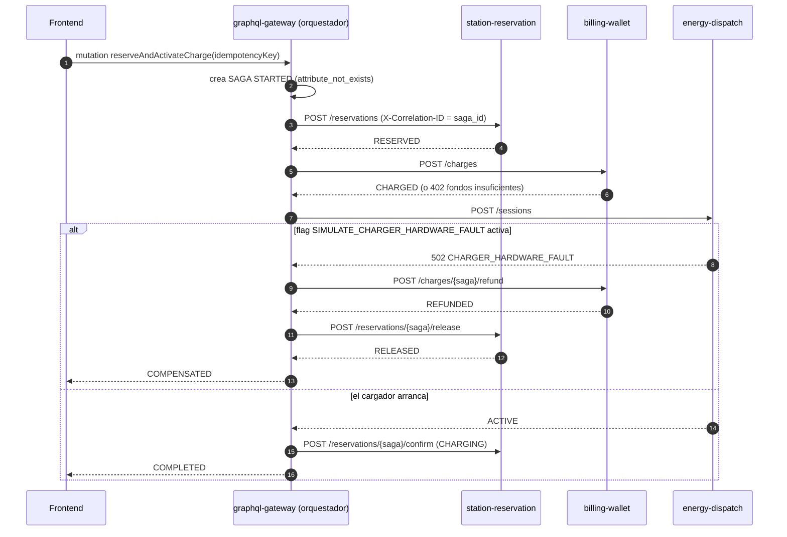
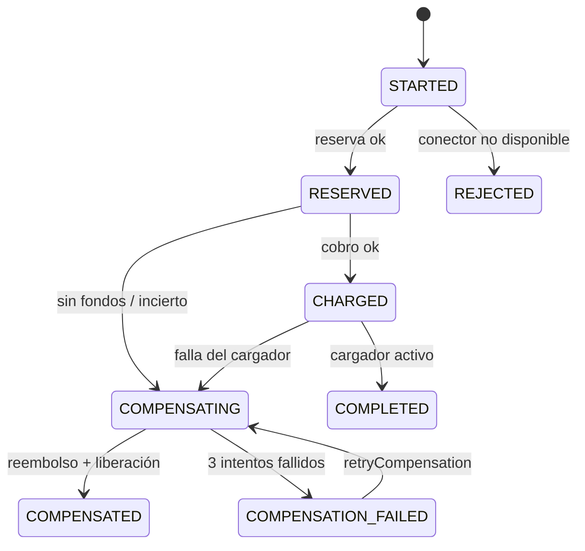

# Arquitectura de AegisVolt

## Decisiones principales

| Decisión | Elección | Motivo |
|---|---|---|
| Estilo de SAGA | **Orquestación** en el graphql-gateway | El flujo tiene un orden estricto y una compensación inversa. Un orquestador lo deja explícito, persistido y auditable (tabla `aegisvolt-sagas-<env>`), y facilita reanudar SAGAs huérfanas. |
| Persistencia | DynamoDB, *Database-per-Service* | Cada servicio es dueño de su tabla. Los cambios locales son atómicos con `TransactWriteItems` y la consistencia global es eventual vía SAGA. |
| Idempotencia | `saga_id` como clave + escrituras condicionales + lápidas `VOIDED` | Reintentos y compensaciones duplicadas no repiten efectos; las peticiones tardías después de un rollback se rechazan. |
| Feature Flags | Propias, tabla DynamoDB por ambiente, caché de 3 s | Aislamiento total entre ambientes y cambio en caliente sin redesplegar. Terraform fija el valor inicial e ignora los cambios posteriores. |
| Canary | Proporción de réplicas (4 stable : 1 canary) tras un mismo Service | Funciona igual en EKS real y en el k3s de Floci, sin service mesh. El análisis combina la sonda in-cluster, CloudWatch Logs y una alarma. |
| Imagen única | La misma imagen se promueve dev → test → prod | El comportamiento por ambiente sale del ConfigMap y de las flags, nunca de builds distintos. |
| Red | Subredes privadas sin ruta a internet | Todo el tráfico a AWS pasa por VPC Endpoints. La entrada es API Gateway privado → VPC Link → NLB interno, con el NLB publicado además como PrivateLink. |

## Flujo "Reservar y Activar Carga"

Si falla el paso 2 por fondos, solo se libera la reserva. Si falla el paso 1 por negocio (conector ocupado), la SAGA queda `REJECTED` sin compensaciones. Un fallo técnico (timeout o 5xx sin código) se trata como **incierto** y también se compensa el paso dudoso; es seguro gracias a las lápidas.

## Estados de la SAGA

Prefect marca como **huérfana** toda SAGA no terminal sin cambios durante más de 5 minutos y verifica que las SAGAs terminadas coincidan con el estado de las tablas de los servicios.

## Modelo de datos

| Tabla | Claves | Items |
|---|---|---|
| `aegisvolt-reservations-<env>` | pk, sk | `CONNECTOR#<id>/META`, `RESERVATION#<saga>/META` |
| `aegisvolt-billing-<env>` | pk, sk | `WALLET#<fleet>/META`, `WALLET#<fleet>/LEDGER#<ts>#<saga>#<tipo>`, `CHARGE#<saga>/META` |
| `aegisvolt-dispatch-<env>` | pk, sk | `SESSION#<saga>/META`, `TELEMETRY#<connector>/<ts>` |
| `aegisvolt-sagas-<env>` | saga_id | estado, pasos, eventos, compensaciones |
| `aegisvolt-feature-flags-<env>` | name | enabled, updated_by, updated_at |

## Ambientes

| | dev | test | prod |
|---|---|---|---|
| Workspace / estado | `env:/dev/...` | `env:/test/...` | `env:/prod/...` |
| VPC | 10.10.0.0/16 | 10.20.0.0/16 | 10.30.0.0/16 |
| Clúster | aegisvolt-dev-eks | aegisvolt-test-eks | aegisvolt-prod-eks |
| Retención de logs | 7 días | 14 días | 30 días |
| Flags iniciales | surge on, boost on | surge on, boost on | todo off (fallo bloqueado) |
| Protección de borrado DynamoDB | no | no | sí |
